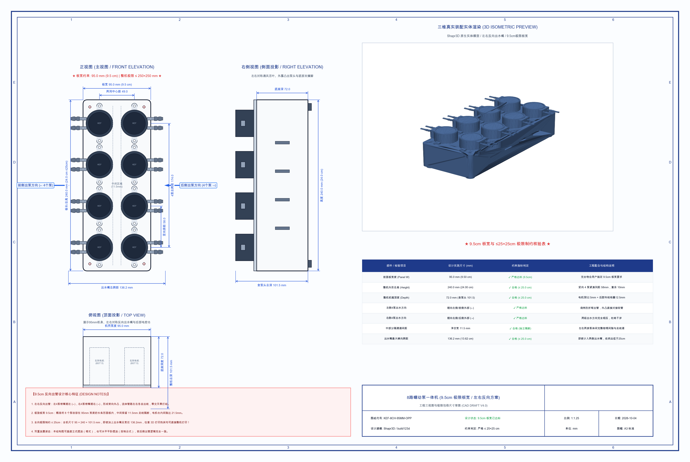
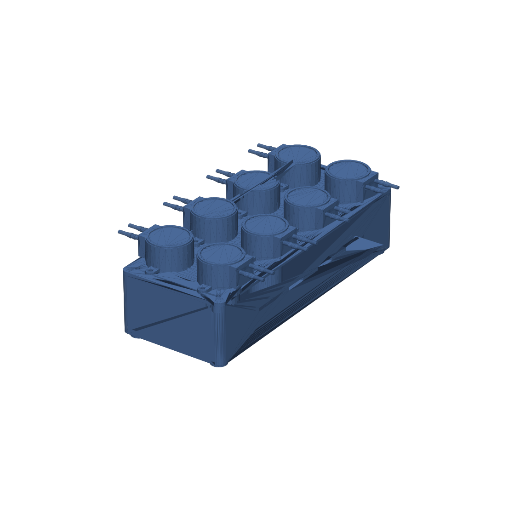

# 8路蠕动泵一体机 3D CAD 工程模型与制造规范 (8-Channel Peristaltic Pump Station)

[](https://github.com/zhangsxphd/Pump_Model)
[](LICENSE)
[](https://github.com/zhangsxphd/Pump_Model)

本项目为基于 **Kamoer（卡默尔）KEF 系列直流蠕动泵** 的 8 通道自动化集成泵站 3D CAD 实体模型与 3D 打印制造方案，支持在 **Shapr3D**、FreeCAD、Fusion 360 及各类 3D 打印切片软件（Bambu Studio, PrusaSlicer, Cura）中直接载入。

---

## 📸 工程蓝图与三维效果预览

### 1. 最新 CAD 标准工程三视图（9.5cm 板宽 / 左右反向出管方案）


### 2. 三维轴测实体装配渲染效果


---

## 🎯 方案核心设计特征

1. **左右背向反向出管（杜绝流体干涉）**：
   - **左侧 4 个泵**：喷嘴朝向左侧/前侧外部（$\leftarrow$）。
   - **右侧 4 个泵**：喷嘴朝向右侧/后侧外部（$\rightarrow$）。
   - 从正面观察形成：`前侧出泵方向 ←【4 个泵】｜中间区域 (11.5mm)｜【4 个泵】→ 后侧出泵方向`。
   - 彻底解决管路交叉打结、软管折弯受阻的问题。
2. **极限板宽 9.5 厘米（95.0 mm）**：
   - 面板宽度严格限定为 **95.0 mm**。
   - 两列电机中心距 49.0 mm，两列泵体间留有 11.5 mm 独立安全通道，仓内电机间隙达 21.5 mm。
3. **严格全向尺寸制约 $\le 25 \times 25\text{ cm}$**：
   - 整机全包络尺寸：$95.0\text{ mm (宽)} \times 240.0\text{ mm (高)} \times 101.5\text{ mm (深)}$。
   - 包含两侧外凸出水嘴的最大总跨距仅为 $136.2\text{ mm}$。
   - 完美适配标准 250×250mm / 256×256mm 打印热床，支持一体成型打印。
4. **灵活姿态支持**：
   - 既可作为**立式塔式**放置，也可平卧作为**桌面控制台式**放置。

---

## 📐 尺寸参数与干涉检测表

| 检验项目 / 部件 | 实测尺寸 (mm) | 等效厘米 (cm) | 判定状态 | 结构裕量与说明 |
| :--- | :--- | :--- | :---: | :--- |
| **前面板宽度 (Panel W)** | **95.0 mm** | **9.50 cm** | **✓ 严格达标** | 完全吻合 9.5cm 板宽要求 |
| **整机外形高度 (Height)** | **240.0 mm** | **24.00 cm** | **✓ 合格 (≤ 25 cm)** | 4 泵坚向排距 58mm，距 25cm 上限富余 10mm |
| **整机底座深度 (Depth)** | **72.0 mm** *(含泵头101.5)* | **7.20 cm** | **✓ 合格 (≤ 25 cm)** | 电机深 52.5mm + 后仓接线裕量 12.5mm |
| **左侧 4 泵出水方向** | **朝向左侧/前侧外部** | **←** | **✓ 严格达标** | 倒角防折弯，软管直接向左侧输出 |
| **右侧 4 泵出水方向** | **朝向右侧/后侧外部** | **→** | **✓ 严格达标** | 两组出水朝向完全相反（背向外凸） |
| **中部分隔通道间距** | **净空 11.5 mm** | **1.15 cm** | **✓ 严格达标** | 左右两列泵体间完整物理隔离与走线道 |
| **出水嘴横向总跨距** | **136.2 mm** | **13.62 cm** | **✓ 合格 (≤ 25 cm)** | 计入两侧突出水嘴，依然远低于 25cm |
| **几何干涉检测 (Clash)** | **0 干涉 (Clear: True)** | - | **✓ 合格** | 14 个独立实体，91 组碰撞检测全部通过 |

---

## 📂 文件目录结构

```
Pump_Model/
├── README.md                                   # 项目主文档与制造规范
├── models/
│   ├── step/                                   # CAD 精确实体模型 (STEP 格式)
│   │   ├── 8_channel_opposite_pumps_95mm.step  # 9.5cm 左右反向整机总装配体
│   │   ├── front_mounting_panel_95mm.step      # 9.5cm 前面板安装板
│   │   ├── chassis_enclosure_95mm.step         # 9.5cm 底座机箱外壳
│   │   ├── kef_peristaltic_pump.step           # Kamoer KEF 泵精确单体模型
│   │   └── 8_channel_pump_station_assembly.step# 紧凑并列方案 (246mm)
│   ├── stl/                                    # 3D 打印三角网格模型 (STL 格式)
│   │   ├── 8_channel_opposite_pumps_95mm.stl
│   │   ├── front_mounting_panel_95mm.stl
│   │   └── chassis_enclosure_95mm.stl
│   └── 3mf/                                    # 现代多体切片工程 (3MF 格式)
│       ├── front_mounting_panel_95mm.3mf
│       └── chassis_enclosure_95mm.3mf
├── blueprints/                                 # 高分辨率工程图纸与渲染图
│   ├── cad_blueprint_95mm_opposite.png         # 9.5cm 反向出管工程草图
│   ├── opposite_pumps_95mm_3d_preview.png      # 9.5cm 三维实体装配图
│   └── cad_blueprint_25cm_compact.png          # 25cm 并列方案工程草图
├── scripts/                                    # 参数化建模与工程出图脚本 (Python / build123d)
│   ├── build_opposite_pumps_95mm.py            # 9.5cm 反向方案实体生成脚本
│   ├── generate_cad_drawing_95mm.py            # 9.5cm 标准蓝图绘制脚本
│   └── render_opposite_pumps_95mm.py           # 3D 轴测实体渲染脚本
└── docs/                                       # 详细技术规范与计算记录
    └── cad_compact_25cm_spec.md
```

---

## 🛠️ 3D 打印与加工建议

1. **材料推荐**：
   - **机箱外壳与前面板**：推荐使用 **PETG** 或 **ABS / ASA**（具备良好的耐化学品、耐水性与耐电机发热温升性能）。
2. **切片打印参数建议**：
   - **层高**：0.2 mm
   - **外壁圈数 (Wall Loops)**：4 圈（增强结构刚性与螺丝自攻握钉力）
   - **填充率 (Infill)**：25% ~ 30% 陀螺线（Gyroid）或网状填充
   - **支撑**：通风槽建议开启树状支撑（Tree Support），其余部位免支撑。
3. **标准紧固件清单**：
   - 4× M3×10 mm 沉头自攻/内六角螺丝（面板与机箱固定，孔距 $76.0 \times 220.0\text{ mm}$）
   - 16× M3×8 mm 沉头螺钉（KEF 蠕动泵安装固定）

---

## 📄 开源许可证

本项目基于 [MIT License](LICENSE) 开源。
